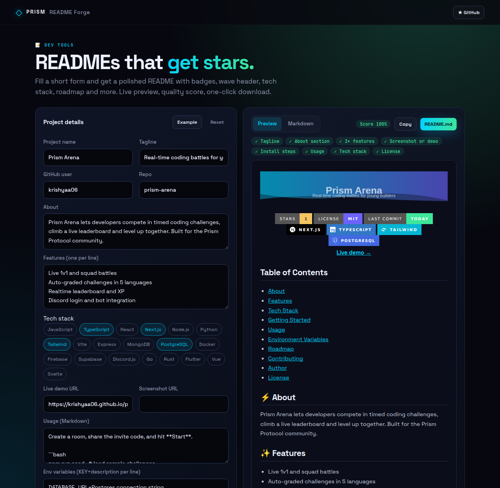
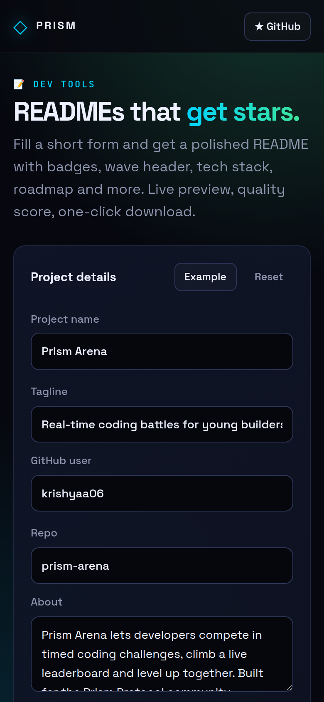

<!-- ═════════════ HEADER ═════════════ -->
<p align="center">
  
</p>

<p align="center">
  
</p>

<p align="center">
  <a href="https://github.com/krishyaa06/prism-readme-forge/actions/workflows/ci.yml"></a>
  <a href="https://krishyaa06.github.io/prism-readme-forge/"></a>
  
  
  <a href="LICENSE"></a>
</p>

<p align="center">
  
</p>


## ⚡ Overview

**Prism README Forge** helps you ship projects that look finished. Describe the project in a short form, pick your stack, and it builds a clean README with a capsule wave header, shields.io badges, install steps, env table, roadmap checklist, contributing guide and license. The live preview renders like GitHub, and a score shows what is still missing.

## ✨ Features

- **Live preview** rendered with a built-in Markdown engine
- **Wave header** (capsule-render) or classic centered title
- **Stack badges** for 20 technologies plus GitHub stars/license/issues/commit badges
- **Sections**: About, Features, Tech Stack, Getting Started, Usage, Env vars, Roadmap, Contributing, Author, License
- **Auto table of contents** and README **quality score**
- Copy or download `README.md`; your draft is saved locally

## 📸 Screenshots

<table>
  <tr>
    <td width="68%"></td>
    <td width="32%"></td>
  </tr>
</table>

## 🚀 Quick Start

**Use it online:** [https://krishyaa06.github.io/prism-readme-forge/](https://krishyaa06.github.io/prism-readme-forge/)

**Run locally:**

```bash
git clone https://github.com/krishyaa06/prism-readme-forge.git
cd prism-readme-forge
# open index.html in your browser, or serve it:
npx serve .
```

## 🛠️ Usage

1. Click **Example** to see a filled-in project, or start typing your own.
2. Toggle stack chips and badge options.
3. Watch the score checklist, then **Copy** or download **README.md**.

## 📁 Project Structure

```
prism-readme-forge/
├── assets/
│   ├── logo.png
│   └── logo.svg
├── css/
│   ├── app.css
│   └── prism.css
├── js/
│   ├── app.js   # form + preview
│   ├── core.js   # README generator + Markdown renderer — tested in Node
│   └── prism.js
├── test/
│   └── core.test.js
├── .gitignore
├── LICENSE
├── index.html
└── package.json
```

## 🧪 Tests

```bash
npm test
```

Tests use the built-in `node:test` runner, so there is nothing to install. CI runs them on Node 20 and 22.

## 🤝 Contributing

1. Fork the repo and create a branch: `git checkout -b feature/my-idea`
2. Make your change and add a test in `test/`
3. Run `npm test` and open a Pull Request

## 🔷 Part of Prism Protocol

Prism README Forge is one of the open-source tools built by [Prism Protocol](https://dc.gg/prismprotocol), a tech community where young builders learn, ship and compete together.

## 👤 Author

<table>
  <tr>
    <td align="center">
      <a href="https://github.com/krishyaa06"><br><b>Soumya Bhandare</b></a><br>
      <sub>Founder @ Prism Protocol</sub>
    </td>
    <td>
      <a href="https://dc.gg/prismprotocol"></a><br>
      <a href="https://instagram.com/prism_protocol_"></a><br>
      <a href="https://x.com/krishyaa06"></a>
    </td>
  </tr>
</table>

## 📄 License

Released under the [MIT License](LICENSE).

<p align="center">
  <b>If you like this project, consider giving it a ⭐</b><br>
  <sub>"Build. Create. Compete." · Made with ⚡ by Prism Protocol</sub>
</p>


